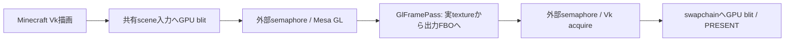

# All For Vulkan 共通コアと移植設計

更新: 2026-10-24。設計方針。`core-api`（`PlatformServices`）、NeoForgeアダプター、`native-bridge`のMesa/Zink・外部画像共有と、AFV VkDeviceへのフレーム合成診断を追加。以下の全体構成への移行は進行中で、描画本体はまだMinecraft依存を含む。CPUアップロード資源の実GL名登録と、リサイズをまたぐGL context寿命も実装。実装済み境界は[開発手順](docs/DEVELOPMENT.md)に記録する。

## 現在の実装経路

1. **AFV native renderer**: VulkanMod由来の地形・GUI描画。任意のIris passの統合は引き続き開発対象。
2. **Zink GL client / AFV Vulkan presentation**: Minecraft・Iris・Sodiumの既存GL描画を実Zinkで動かし、最終色画像をAFVのVkDeviceとWSIへ外部メモリ・セマフォで渡す。GLのMRT・影・資源管理はIrisとドライバーが担当する。この経路ではAFV native地形描画を使用しない。

2の接続はNeoForgeのウィンドウ／フレームMixinと`ZinkClientSession`、Vulkan側の`ZinkPresenter`、共通`native-bridge`の`ZinkContext`・`SharedImage`で構成する。Vulkanの初期化を表示用とnative描画用に分け、表示専用経路でnative terrain・VMA・シェーダーパイプラインを初期化しない。配布起動時のGLFW親ローダーとVulkan子ローダーの境界は、WSI生成へネイティブhandleを渡すことで越える。別プロセスの起動前検査で、未対応Zinkをゲームへ読み込む前にOpenGLへ戻す。

GLクライアント経路の導入は、下記の共通API化・全GL入口／コンテキスト形式・全OS対応の完了を意味しない。

## 目的

初期対象はMinecraft 1.21.1 / NeoForge。将来のFabric版と、過去のMinecraftに対応したForge版で描画・GL互換処理を共有する。
VulkanMod本家からフォークしたコードを一つのリポジトリで管理し、ローダーごとに独立した描画実装を育てない。

互換性を三つの軸に分ける。

| 軸 | 例 | 吸収する場所 |
| --- | --- | --- |
| MODローダー | NeoForge / Fabric / Forge | 起動・イベント・MOD検出・設定・メタデータのアダプター |
| Minecraftの版 | 描画フック、頂点形式、リソース、ウィンドウ連携の差 | Minecraft版ごとの描画アダプター |
| 実行環境 | Java / LWJGL / OS / CPU / GPU / ネイティブABI | ビルド対象とネイティブ接続層、実機の機能照会 |

ここでのFabric対応は、同じコアからFabric向けAFVをビルド・配布することを指す。
Fabric用MODをNeoForge上でロードする機能は別の互換機構であり、この構造だけで実現するとは扱わない。
Forgeへの後方互換も、その対象Minecraft・Java・LWJGLに合わせたビルドとアダプターを用意する意味とする。

## モジュール案と依存方向

```text
platform-neoforge ─┐
platform-fabric ───┼─→ 選択したminecraft-<version> ─→ core-vulkan ─┐
platform-forge ────┘                    │              core-gl ───┼─→ core-api
                                      └─→ MOD別連携            │
                                          core-gl ─→ native-bridge
```

各platformモジュールは配布物の組立ても担当する。core-vulkanとcore-glは互いの実装へ依存せず、core-apiの資源・同期契約で協調する。

| モジュール | 責務 | 許可する依存 |
| --- | --- | --- |
| `core-api` | 資源記述、機能情報、フレーム/描画段階、所有権・同期の契約 | Java標準型と自前の値型。Minecraft・ローダー・LWJGL型を公開しない |
| `core-vulkan` | VulkanMod由来のGPU描画、パイプライン、メモリ、キュー、共有資源 | core-apiと選定したVulkanバインディング。Minecraft・ローダー型を含めない |
| `core-gl` | GLコンテキスト管理、Mesa/Zinkの制御、GL/Vulkan資源対応、状態境界 | core-api、native-bridge。Minecraft・ローダー型を含めない |
| `native-bridge` | Mesaのロード、関数解決、外部handle、OS別のネイティブ処理 | OSとネイティブABI。Minecraft・ローダー型を含めない |
| `minecraft-<version>` | ウィンドウ、地形・entity等の入力変換、描画フック、再読込、共有するmixin | 対象版のMinecraft、共通コア。ローダー固有箇所はplatform側へ委譲 |
| `platform-<loader>` | エントリーポイント、早期起動、イベント、MOD検出、設定保存、配布メタデータ | 対象ローダー、対象Minecraftアダプター、コアの組立て |
| `compat-iris-<target>`等 | 対象MODの検出条件、mixin、頂点形式・描画段階の接続 | 対象MOD、対象Minecraftアダプター、core-api。ローダー差は対象別ソースへ隔離 |

移植時点でこれらをすべて別のGradleサブプロジェクトにする必要はない。実際の依存で分離を確認できる単位から切り出す。
VulkanModに含まれるMinecraft依存の地形構築や描画コードはMinecraftアダプター側へ残す。フォルダー名をcoreに変えるだけで共通化済みとはしない。

## 境界となる契約

APIは試作の実データに合わせて小さく定める。最初からMinecraft全体の汎用抽象化は作らない。

| 契約案 | 提供するもの | 具体的な境界 |
| --- | --- | --- |
| `PlatformServices` | 設定値、パス、MOD一覧、ログ、タスクの実行先 | コアがローダーのイベントや設定オブジェクトを受け取らない |
| `RenderHost` | ウィンドウ/描画面の情報、サイズ、描画スレッドへの実行要求 | MinecraftのWindowやRenderSystemをコアへ渡さない |
| `SceneInput` | 頂点/インデックス、マテリアル、カメラ、地形等の描画入力 | Minecraft版ごとのデータを境界で変換する。毎drawの不要なコピーを避ける |
| `FrameContext` / `RenderStage` | フレーム識別と描画段階、読書き可能な資源 | 単なるbefore/afterイベントにせず、描画先と同期条件を定義する |
| `SharedResourceRegistry` | 画像/バッファの記述、共有可否、所有者、外部handleの受渡し | VkImage・GL ID・OS handleの寿命を混同しない |
| `GpuCapabilities` / `InteropSession` | 利用可能な機能と共有接続、待機/通知の契約 | ローダー名でGL/Vulkan機能の有無を決めない |

core-apiが公開するのは自前の不透明な資源識別子と記述情報とし、VkDevice等の具体型は実装内に閉じる。
別VkDeviceをまたぐ共有の実装はcore-vulkan、core-gl、native-bridgeに置く。共通API化しても資源共有の制約が消えるわけではない。

## 初期化と終了

起動の進行は共通のコーディネーターが管理し、platformはローダーごとの適切なタイミングで呼ぶ。

1. 設定・対象環境・ネイティブ版を確認し、OpenGLライブラリや関数解決が固定される前に必要な初期設定を行う。
2. ウィンドウとVulkan描画本体を初期化する。
3. Mesa/Zinkコンテキストを作り、GPU・共有形式・同期機能を確認する。
4. 共有資源とMOD連携を接続し、通常描画を開始する。
5. 終了時は新規の描画要求を止め、使用中の資源の完了を待ち、連携・共有資源・GL・Vulkanを逆依存順で解放する。

具体的な順序はM1で確定する。ネイティブ初期化をstatic initializerや通常のMOD初期化イベント任せにしない。
途中失敗時も、初期化できた範囲だけを逆順で解放する。
共通コアにMinecraftのシングルトンを持ち込まず、描画セッションごとの状態として管理する。

resize、ワールド切替、リソース再読込、shader切替では、資源の世代を更新する。
旧世代はGPUで使用中のフレームが完了してから解放し、MODアダプターが古いGL IDやGPU資源を保持し続けない契約にする。
これらの寿命・同期処理はコアに集約し、各ローダーは対応するイベントを共通操作へ変換する。

## Mixinと他MODとの接続

- Minecraft依存のmixinは対象版のアダプターに置く。ローダー固有の対象やイベントだけplatform側へ置く。
- LWJGLへのmixinと、VulkanMod内部のGL呼び出し経路整理は、適用条件と初期化順序を明示する。複数platformが同じ置換を重複登録しない。
- Iris等の互換処理は専用モジュールへ置く。対象MODがない環境では、その型やクラスを解決しない。
- Iris/Sodium等の組合せは、MOD IDだけでなく版と利用する描画機能で判定する。将来のForge向けにも必要な実装を対象別に接続する。
- ローダーやMOD版の判定は起動・接続時に済ませる。描画ループでreflectionやローダー分岐を繰り返さない。
- GL機能の差とMinecraft/ローダー差を別に管理する。任意のMODを載せる仕組みと、描画の互換処理を混同しない。

## ソース、ビルド、配布

単一リポジトリ内で共通コアと対象別アダプターを管理し、配布JARはMinecraft版・ローダーごとに生成する。
利用者は対象のAFV JARを一つ導入し、そのJARが対応するコアを内包する。すべてのローダー用クラスを一つのJARに無条件で詰め込まない。
Mesa/ZinkはOS・CPU・ABI別のネイティブ成果物として管理し、Java側と対応する版を固定する。

初期開発はJava 21を使う。将来のForge対象で古いJavaが必要なら、その環境で動くclass fileと依存ライブラリを別途ビルドする。
共通コアの最低Java版は、その対象を選定した時点で決める。Java 21用JARがそのまま古いJavaで動くとは扱わない。
当初からJava版依存APIを必要以上に境界へ露出させず、MinecraftやLWJGLの具体型も閉じ込める。

共通の開発mappingと各ローダー向けのremap方法はM0で固定する。mapping済みのMinecraftクラスを公開コアAPIに含めない。
マルチローダー用ツールの採用は実際の移植で選ぶ。描画コアの設計を特定の移植フレームワークへ依存させない。
VulkanMod本家からの取り込み履歴を残し、移植差分・GL統合差分・元の描画コードを追える形で管理する。

## 段階的な導入

| 時期 | 行うこと | 完了の判断 |
| --- | --- | --- |
| M0 | 本家からフォーク、NeoForge移植、Minecraft/ローダーとGPU処理の境界を切る | コアからのMinecraft・ローダー依存を明示でき、NeoForgeで起動・描画できる |
| M1〜M3 | Zink共有・汎用GL・Iris接続を上記の境界に沿って実装 | 機能固有の処理が各platformに複製されず、NeoForgeの実描画が成立する |
| Fabric展開 | 同じMinecraft版でFabricアダプターと配布物を追加 | 同じコアのソースとテストを利用し、Fabricで実描画を確認する |
| Forge後方対応 | 対象Minecraft/Javaを固定し、その版の描画・MODアダプターを追加 | 別ビルドの同じコアで動作を確認し、対象版と機能差を公開する |

後方対応の具体的なMinecraft版は未指定。初期のNeoForge 1.21.1を進めながら境界を用意し、過去版の実装を先回りして大量に作らない。
FabricとForge向けの配布・テストを実施するまでは、それぞれ対応済みとは表記しない。

## 実装後に守る検証境界

コアの資源寿命・同期・状態処理は共通テスト、Minecraft版差は描画アダプターの検証、ローダー差は起動・イベント・配布物の検証で扱う。
対応対象を増やした後は、対象版/ローダー別のビルドをCIへ追加する。ネイティブ接続と実描画は必要なOS/GPU環境で確認する。
同一のテストシーンを使い、Irisの影・半透明・再読込・resize等の結果を比較する。
共通化はソースの重複削減と挙動の統一のために行い、抽象化のための毎drawの資源再生成・同期・データコピーは導入しない。


## 実装済みのフレーム色画像境界

`afv.zinkInterop` 指定時に限り、Minecraftの通常描画が終わった位置で
frame slotごとの共有入力へVk blitし、入力/出力画像のqueue ownershipを外部へ渡す。
そのVk command bufferをimageAvailable待ちで先にsubmitしてから、Mesa側で
`GlFramePass.render(Frame)` を呼ぶ。入力textureと出力FBOはその呼び出し中だけ借用する。
GLの完了semaphoreを待つ2本目のVk command bufferが両画像をacquireし、
出力をswapchainへblitしてPRESENTへ遷移する。最終submitに通常のframe fenceを付ける。



GL context、CPU画像のregistry、frame passの寿命はrendererと同じ。
resizeではGPUを既存の境界でdrainし、サイズ依存の入力/出力画像とcomposition
command bufferだけを再生成する。製品のフレーム輸送にCPU readbackは用いない。
`SceneColorPass` は接続確認用のidentity/invert後処理で、Irisバックエンドではない。
現状の位置はGUIを含むフレーム描画の後。Irisにはworld内の各描画段階、深度、
shadow/MRT、Sodiumの頂点/terrainフック、資源registryの追加統合が必要。
